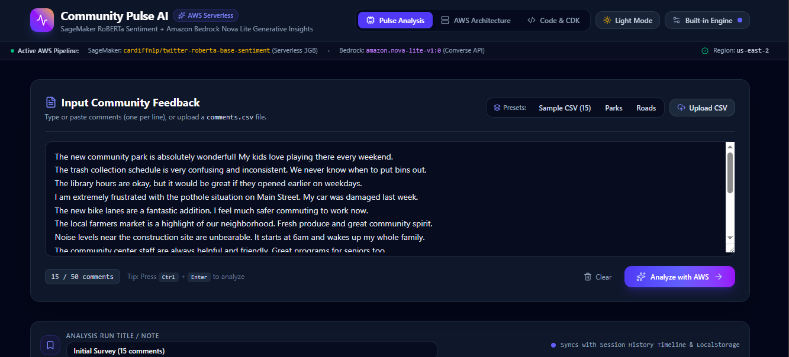

# 🌟 Community Pulse AI

<div align="center">


**Análisis de retroalimentación comunitaria con Machine Learning e IA generativa en AWS**

*Diseñado y desarrollado por Orli Dun*


### 🚀 Live Demo

**[Abrir Community Pulse AI](https://main.d3kbp6sdt6ba8z.amplifyapp.com)**

Aplicación desplegada mediante AWS Amplify Hosting.

</div>

---

> **Estado del proyecto — actualizado el 21 de noviembre de 2026.** Community Pulse AI cuenta con un frontend desplegado públicamente en AWS Amplify Hosting y un backend operativo sobre Amazon API Gateway, AWS Lambda y Amazon SageMaker. La API respondió correctamente con HTTP 200 durante las pruebas en producción. Se completó un piloto sintético de evaluación de 90 registros contra el endpoint desplegado de SageMaker. La exportación CSV y JSON también fue validada. La integración con Amazon Bedrock Nova Lite está implementada en el código, pero la invocación del modelo continúa bloqueada por autorización de AWS. El despliegue de Amplify fue satisfactorio; queda pendiente completar una prueba integral desde la URL pública para verificar el comportamiento del frontend y su comunicación con la API.

## 📚 Índice

1. [Descripción del proyecto](#1--descripción-del-proyecto)
2. [Estado actual de la implementación](#2--estado-actual-de-la-implementación)
3. [Arquitectura](#3--arquitectura)
4. [Servicios de AWS y tecnologías](#4--servicios-de-aws-y-tecnologías)
5. [Modelos y resultados de evaluación](#5--modelos-y-resultados-de-evaluación)
6. [Requisitos e instalación local](#6--requisitos-e-instalación-local)
7. [Configuración](#7--configuración)
8. [Ejecución de la aplicación](#8--ejecución-de-la-aplicación)
9. [Pruebas y evaluación](#9--pruebas-y-evaluación)
10. [Uso de la API](#10--uso-de-la-api)
11. [Despliegue en AWS](#11--despliegue-en-aws)
12. [Costos y consideraciones operativas](#12--costos-y-consideraciones-operativas)
13. [Limpieza de recursos](#13--limpieza-de-recursos)
14. [Aprendizajes y próximos pasos](#14--aprendizajes-y-próximos-pasos)
15. [Créditos y licencia](#15--créditos-y-licencia)

---

## 1. 🌟 Descripción del proyecto

**Community Pulse AI** es un prototipo de aplicación serverless que analiza la retroalimentación de comunidades. Combina un modelo de clasificación de sentimientos de tres categorías alojado en Amazon SageMaker con una etapa opcional de análisis generativo implementada mediante Amazon Bedrock.

La aplicación acepta hasta **50 comentarios por solicitud** y, cuando el flujo de inferencia de AWS está disponible, devuelve:

- Una etiqueta positiva, neutral o negativa para cada comentario.
- Una puntuación devuelta por el modelo para cada predicción.
- Recuentos y porcentajes agregados por categoría de sentimiento.
- Un resumen generativo, temas principales, insights y acciones sugeridas cuando la invocación de Bedrock está autorizada y disponible.

La clasificación de sentimientos y el análisis generativo son etapas separadas. De esta manera, los resultados de SageMaker siguen siendo útiles aunque la etapa generativa no esté disponible.

### Funcionalidades principales

| Funcionalidad | Implementación | Estado actual |
|---|---|---|
| Clasificación de sentimientos en tres categorías | CardiffNLP RoBERTa en SageMaker Serverless | ✅ Desplegada e invocada correctamente |
| Agregación de sentimientos | Backend Python | ✅ Implementada y probada |
| Resumen y recomendaciones generativas | Amazon Bedrock Converse con Nova Lite | ⚠️ Implementado; autorización de invocación pendiente |
| Respuesta parcial como alternativa | Lambda devuelve los resultados de sentimientos si Bedrock falla | ✅ Desplegada y verificada |
| Dashboard interactivo | React, TypeScript y Vite | ✅ Compilado y desplegado en AWS Amplify |
| Historial de análisis | Frontend React | ✅ Implementado |
| Exportación de resultados | CSV y JSON | ✅ Probada |
| Flujo de evaluación | Piloto sintético de 90 registros e informe de métricas | ✅ Ejecutado contra el endpoint desplegado de SageMaker |
| Hosting público del frontend | AWS Amplify Hosting | ✅ Desplegado; validación integral pública pendiente |

---

## 2. ✅ Estado actual de la implementación

El siguiente estado refleja comprobaciones realizadas el **21 de noviembre de 2026**. No constituye una declaración de preparación empresarial o certificación para producción.

| Componente | Estado verificado | Evidencia / notas |
|---|---|---|
| AWS Amplify Hosting | ✅ Desplegado | Aplicación pública disponible en el dominio de Amplify |
| API Gateway REST API | ✅ Responde | `POST /prod/analyze` devolvió HTTP 200 |
| AWS Lambda | ✅ Desplegada | Python 3.12, memoria de 512 MB y timeout de 60 segundos |
| Endpoint de SageMaker | ✅ `InService` | Serverless, 3072 MB y concurrencia máxima de 5 |
| Clasificación de sentimientos | ✅ Funciona | Una prueba con dos comentarios devolvió uno positivo y uno negativo |
| Fallback de Lambda | ✅ Funciona | La respuesta incluye `analysis_status: "partial"` cuando Bedrock falla |
| Pruebas backend | ✅ 61 superadas | `pytest backend/tests -q` |
| Verificación de tipos frontend | ✅ Superada | `npm run lint` (`tsc --noEmit`) |
| Compilación de producción frontend | ✅ Superada | `npm run build` |
| Despliegue frontend | ✅ Completado | AWS Amplify, rama `main`, compilación automática |
| Exportación CSV | ✅ Validada | Exportación de los 15 comentarios de prueba |
| Exportación JSON | ✅ Validada | Historial de ejecuciones exportado correctamente |
| Piloto completo de evaluación | ✅ 90/90 invocaciones completadas | Resultados en [`evaluation/BASELINE_RESULTS.md`](evaluation/BASELINE_RESULTS.md) |
| Bedrock Nova Lite | ⚠️ Sin autorización | `GetFoundationModelAvailability` devolvió `NOT_AUTHORIZED`; `Converse` devolvió `ValidationException: Operation not allowed` |
| Prueba integral desde URL pública | ✅ Smoke test exitoso | Se analizó un comentario desde AWS Amplify; el frontend recibió y presentó correctamente la clasificación generada mediante SageMaker. |

### URL pública

**Aplicación:**

https://main.d3kbp6sdt6ba8z.amplifyapp.com

**Configuración del despliegue:**

| Parámetro | Valor |
|---|---|
| Servicio | AWS Amplify Hosting |
| ID de aplicación | `d3kbp6sdt6ba8z` |
| Repositorio | `Orliluq/Community-Pulse-AI` |
| Rama | `main` |
| Directorio raíz del monorepo | `frontend` |
| Comando de compilación | `npm run build` |
| Directorio de salida | `dist` |
| SSR | Deshabilitado |
| Dominio | Dominio HTTPS administrado por Amplify |
| Despliegue automático | Habilitado para la rama conectada |

**Evidencia de la primera implementación:**

- Fecha: 21 de noviembre de 2026.
- Hora indicada por AWS: 15:57.
- Duración total informada: 53 segundos.
- Etapa de compilación: 51 segundos.
- Etapa de publicación: 1 segundo.
- Resultado mostrado por Amplify: `Implementación realizada`.

El dominio público está activo como dirección asignada por Amplify. Todavía no se ha configurado un dominio personalizado ni AWS WAF.

### Estados de respuesta

La respuesta de la API incluye el campo `analysis_status`:

- `complete`: se completaron la clasificación de sentimientos y el análisis generativo.
- `partial`: se completó la clasificación de sentimientos, pero el análisis generativo no estuvo disponible.
- `demo`: simulación local del frontend; no se realizó inferencia en AWS.

Las respuestas antiguas o externas pueden no incluir este campo opcional. En ese caso, el frontend muestra que el origen no fue informado, en lugar de asumir que se utilizó Bedrock.

---

## 3. 🏗️ Arquitectura

La solución está dividida en dos partes independientes:

1. **Frontend:** aplicación React + TypeScript + Vite alojada en AWS Amplify Hosting.
2. **Backend:** API serverless con API Gateway, Lambda y SageMaker, con una etapa generativa opcional mediante Bedrock.

```text
┌─────────────────────────────────────────────────────────────┐
│                    USUARIO / NAVEGADOR                      │
└──────────────────────────────┬──────────────────────────────┘
                               │ HTTPS
                               ▼
┌─────────────────────────────────────────────────────────────┐
│                   AWS AMPLIFY HOSTING                       │
│                                                             │
│                 Frontend React + TypeScript                 │
│                           + Vite                            │
│                                                             │
│                  Dominio público HTTPS                      │
└──────────────────────────────┬──────────────────────────────┘
                               │ POST /analyze
                               ▼
┌─────────────────────────────────────────────────────────────┐
│              AMAZON API GATEWAY REST API                    │
│                    /prod/analyze                            │
└──────────────────────────────┬──────────────────────────────┘
                               │ Integración Lambda Proxy
                               ▼
┌─────────────────────────────────────────────────────────────┐
│                       AWS LAMBDA                            │
│                  Python 3.12 · 512 MB                        │
│                                                             │
│  1. Valida la solicitud                                     │
│  2. Clasifica cada comentario mediante SageMaker            │
│  3. Agrega etiquetas y puntuaciones                         │
│  4. Intenta invocar Bedrock Converse                        │
│  5. Devuelve una respuesta completa o parcial               │
└────────────────┬───────────────────────────┬────────────────┘
                 │ InvokeEndpoint             │ Converse
                 ▼                            ▼
┌──────────────────────────────┐  ┌──────────────────────────────┐
│ AMAZON SAGEMAKER SERVERLESS  │  │ AMAZON BEDROCK               │
│                              │  │                              │
│ CardiffNLP RoBERTa           │  │ Amazon Nova Lite             │
│ 3 categorías de sentimiento  │  │ amazon.nova-lite-v1:0        │
│                              │  │                              │
│ negative / neutral /         │  │ Resumen, temas, insights y   │
│ positive                     │  │ acciones sugeridas           │
│                              │  │                              │
│ 3072 MB                      │  │ Autorización de invocación   │
│ Concurrencia máxima: 5       │  │ pendiente                    │
└──────────────────────────────┘  └──────────────────────────────┘

                 │
                 ▼
┌─────────────────────────────────────────────────────────────┐
│                    AMAZON CLOUDWATCH                        │
│              Logs, monitoreo y diagnóstico                  │
└─────────────────────────────────────────────────────────────┘
```

### Flujo de una solicitud

1. El navegador envía los comentarios a `POST /analyze`.
2. AWS Amplify sirve la interfaz; la API se consume directamente desde el frontend.
3. API Gateway invoca la función Lambda.
4. Lambda valida la solicitud y llama a SageMaker una vez por comentario, de forma secuencial.
5. El adaptador de sentimientos normaliza las etiquetas y puntuaciones del modelo; el backend agrega los resultados.
6. Lambda intenta generar el análisis mediante Bedrock Converse.
7. Si Bedrock no está disponible, Lambda devuelve los resultados de sentimientos ya calculados, establece `analysis_status: "partial"` e incluye un mensaje explicativo.
8. El frontend muestra el origen y el estado informados por la respuesta.

### Consideraciones sobre la latencia serverless

El endpoint de SageMaker puede reducir su capacidad cuando permanece inactivo. Durante las pruebas se observó un arranque en frío: una inferencia tardó aproximadamente 20 segundos, mientras que las solicitudes posteriores generalmente tardaron menos de un segundo.

La API Gateway actual es de tipo **Edge-Optimized** y tiene un timeout de integración de aproximadamente 29 segundos. Por ello, un arranque en frío o un lote grande procesado secuencialmente puede provocar una respuesta HTTP 504 aunque Lambda continúe ejecutándose.

El frontend realiza actualmente un único reintento después de recibir un HTTP 504. Es una mitigación, no una garantía contra todos los timeouts.

---

## 4. 🔧 Servicios de AWS y tecnologías

### Servicios de AWS

| Servicio | Función en el proyecto | Estado actual |
|---|---|---|
| AWS Amplify Hosting | Alojamiento del frontend y despliegue desde GitHub | ✅ Desplegado |
| Amazon SageMaker | Aloja el clasificador de sentimientos mediante un endpoint Serverless | ✅ Activo y probado |
| AWS Lambda | Valida, orquesta, agrega y devuelve los resultados | ✅ Activa y probada |
| Amazon API Gateway | Expone el endpoint REST `POST /analyze` | ✅ Activo y probado |
| Amazon Bedrock | Análisis generativo opcional mediante Converse | ⚠️ Autorización de invocación pendiente |
| Amazon CloudWatch Logs | Registros de ejecución y diagnóstico de Lambda | ✅ Configurado |
| Amazon CloudWatch Dashboard | Panel de monitoreo de la aplicación | ✅ Configurado |
| Amazon CloudWatch Alarms | Alarma operativa para errores de Lambda | ✅ Configurada |
| AWS CDK | Infraestructura como código (IaC) | ⚠️ Código disponible; hay que reconciliar cambios manuales antes de un nuevo despliegue completo |

### Tecnologías de la aplicación

| Tecnología | Propósito |
|---|---|
| Python 3.12 | Backend y herramientas de evaluación |
| boto3 / botocore | SDK de AWS para Python |
| pytest | Pruebas del backend |
| React | Interfaz de usuario |
| TypeScript | Tipos y verificación estática del frontend |
| Vite | Servidor de desarrollo y compilación de producción |
| CardiffNLP RoBERTa | Modelo de clasificación de sentimientos en tres categorías |
| scikit-learn | Métricas de evaluación y matrices de confusión |
| matplotlib | Visualización de resultados de evaluación |
| Mermaid | Diagramas de arquitectura en documentación |

---

## 5. 🤖 Modelos y resultados de evaluación

### Modelo de sentimientos en SageMaker

- **Modelo:** `cardiffnlp/twitter-roberta-base-sentiment`.
- **Tarea:** clasificación de sentimientos en tres categorías.
- **Etiquetas:** `negative`, `neutral` y `positive`.
- **Alojamiento:** Amazon SageMaker Serverless Inference.
- **Configuración observada del endpoint:** 3072 MB de memoria y concurrencia máxima de 5.

El modelo base está orientado al inglés. Los resultados en español incluidos en este repositorio son una prueba exploratoria de transferencia entre idiomas y **no deben interpretarse como soporte validado para español**.

### Modelo generativo en Bedrock

- **ID configurado en la aplicación:** `amazon.nova-lite-v1:0`.
- **API:** Amazon Bedrock Converse.
- **Salida prevista:** resumen, temas principales, insights y acciones sugeridas.
- **Estado actual:** la invocación del modelo no está autorizada en el proyecto/región de AWS evaluados.

Las llamadas reales devolvieron `ValidationException: Operation not allowed` y la consulta de disponibilidad informó `authorizationStatus: NOT_AUTHORIZED`.

La integración permanece en el código, pero el proyecto no afirma que la inferencia de Bedrock esté funcionando. El fallback de Lambda mantiene disponible la clasificación de sentimientos mientras se investiga el problema de autorización de AWS.

Durante la misma validación, la cuota aplicada de Service Quotas `L-45E0AD92` (tokens diarios de invocación del modelo Amazon Nova Lite) tenía un valor de `0` y aparecía como no ajustable. La consulta de la cuota predeterminada de AWS devolvió `5.760.000.000`, mientras que la autorización del modelo continuó en `NOT_AUTHORIZED`.

Estas observaciones no demuestran por sí solas que la cuota sea la causa del error de autorización. AWS Support debe confirmar si existe relación y qué acción se requiere. Se trata de un diagnóstico puntual del 21 de noviembre de 2026, no de una característica permanente del modelo o del servicio.

### Piloto completo de evaluación sintética — 21 de noviembre de 2026

El piloto contiene 90 comentarios sintéticos: 45 en inglés y 45 en español, equilibrados entre las etiquetas de referencia positiva, neutral y negativa (15 ejemplos por cada combinación de idioma y clase). Se ejecutó contra el endpoint de SageMaker desplegado.

| Subconjunto | Predicciones correctas | Muestras | Accuracy |
|---|---:|---:|---:|
| Inglés | 41 | 45 | **91,11 %** |
| Español | 15 | 45 | **33,33 %** |
| Total | 56 | 90 | **62,22 %** |

#### Métricas en inglés

| Clase | Precision | Recall | F1-score |
|---|---:|---:|---:|
| Negativo | 1,000 | 0,800 | 0,889 |
| Neutral | 0,824 | 0,933 | 0,875 |
| Positivo | 0,938 | 1,000 | 0,968 |

Matriz de confusión (filas: etiquetas esperadas; columnas: etiquetas predichas; orden: negativa, neutral, positiva):

```text
[[12,  3,  0],
 [ 0, 14,  1],
 [ 0,  0, 15]]
```

#### Métricas en español

| Clase | Precision | Recall | F1-score |
|---|---:|---:|---:|
| Negativo | 0,000 | 0,000 | 0,000 |
| Neutral | 0,333 | 1,000 | 0,500 |
| Positivo | 0,000 | 0,000 | 0,000 |

Matriz de confusión (filas: etiquetas esperadas; columnas: etiquetas predichas; orden: negativa, neutral, positiva):

```text
[[ 0, 15,  0],
 [ 0, 15,  0],
 [ 0, 15,  0]]
```

Los 45 comentarios en español fueron clasificados como neutrales. La accuracy general oculta esta diferencia sustancial entre idiomas. Por tanto, el modelo actual no debe describirse como un clasificador bilingüe validado.

#### Latencia observada

| Métrica | Resultado |
|---|---:|
| Media | 472,688 ms |
| Mediana | 466,096 ms |
| P95 (rango más cercano) | 512,162 ms |

Son tiempos de invocación secuencial observados desde el cliente para el piloto completo. Pueden incluir red, colas del servicio y efectos de Serverless; no representan exclusivamente el tiempo de cómputo del modelo.

#### Advertencias y limitaciones de la evaluación

- El conjunto de datos es sintético y utiliza etiquetas de referencia asignadas manualmente.
- Este piloto es una comprobación controlada inicial, no un benchmark representativo ni una afirmación de accuracy en producción.
- Los resultados de inglés y español deben comunicarse por separado.
- El resultado en español muestra que el modelo actual no es adecuado para la clasificación de sentimientos en tres categorías en español dentro de este piloto.
- Antes de cambiar el modelo o afirmar que existe soporte bilingüe, debe evaluarse un candidato multilingüe con el mismo conjunto de datos y las mismas métricas.

Resultados detallados y notas para reproducir la evaluación: [`evaluation/BASELINE_RESULTS.md`](evaluation/BASELINE_RESULTS.md).

---

## 6. 📦 Requisitos e instalación local

### Requisitos previos

- Python 3.12.
- Node.js y npm compatibles con el proyecto frontend.
- Git.
- AWS CLI v2 para consultar o invocar recursos de AWS desplegados.
- Una identidad de AWS con permisos para invocar el endpoint de SageMaker durante la evaluación o para utilizar la API desplegada en las pruebas en vivo.

### Clonar el repositorio

```bash
git clone https://github.com/Orliluq/Community-Pulse-AI.git
cd Community-Pulse-AI
```

### Entorno de pruebas del backend

Desde la raíz del repositorio:

```bash
python -m venv .venv

# Git Bash / macOS / Linux
source .venv/bin/activate

# Windows PowerShell:
# .\.venv\Scripts\Activate.ps1

python -m pip install --upgrade pip
python -m pip install -r backend/lambda/requirements.txt
python -m pip install pytest
```

### Dependencias del frontend

```bash
cd frontend
npm install
cd ..
```

### Dependencias de evaluación

```bash
python -m pip install -r evaluation/requirements.txt
```

---

## 7. ⚙️ Configuración

### Credenciales de AWS para la evaluación

Configura las credenciales mediante un proveedor autorizado de AWS CLI. Por ejemplo, si el perfil local se llama `TU_PERFIL_AWS`:

```bash
export AWS_PROFILE=TU_PERFIL_AWS
export AWS_REGION=us-east-2
export AWS_DEFAULT_REGION=us-east-2
export SAGEMAKER_ENDPOINT_NAME=community-pulse-sentiment
```

En Windows PowerShell puedes utilizar:

```powershell
$env:AWS_PROFILE = "TU_PERFIL_AWS"
$env:AWS_REGION = "us-east-2"
$env:AWS_DEFAULT_REGION = "us-east-2"
$env:SAGEMAKER_ENDPOINT_NAME = "community-pulse-sentiment"
```

No incluyas en Git claves de acceso de AWS, tokens de sesión, configuraciones locales de AWS ni archivos `.env.local`.

### URL de la API para el frontend

Crea `frontend/.env.local`:

```env
VITE_API_URL=https://jcnyqrggyj.execute-api.us-east-2.amazonaws.com/prod
```

Utiliza la URL base de la API terminada en `/prod`, **sin** `/analyze`; el frontend agrega `/analyze` automáticamente.

La variable correcta es `VITE_API_URL`, no `REACT_APP_API_URL`.

El archivo `.gitignore` excluye los archivos `.env*`, excepto `.env.example`. Nunca incluyas credenciales en variables de entorno del frontend: las variables de Vite se incorporan al código que recibe el navegador.

Si `VITE_API_URL` no está configurada y tampoco se proporciona una URL personalizada desde los ajustes de la aplicación, el frontend utiliza el flujo de demostración local basado en un léxico de palabras clave. Los resultados de este modo se identifican con `demo` y no corresponden a inferencias de AWS.

### Variables de entorno en AWS Amplify

La aplicación publicada utiliza estas variables:

| Clave | Valor |
|---|---|
| `AMPLIFY_DIFF_DEPLOY` | `false` |
| `AMPLIFY_MONOREPO_APP_ROOT` | `frontend` |
| `VITE_API_URL` | `https://jcnyqrggyj.execute-api.us-east-2.amazonaws.com/prod` |

La variable `VITE_API_URL` permite que el frontend publicado se comunique con Amazon API Gateway.

---

## 8. 🚀 Ejecución de la aplicación

### Iniciar el frontend localmente

```bash
cd frontend
npm run dev
```

El script actual del proyecto inicia Vite en:

```text
http://localhost:3000
```

El puerto está definido explícitamente en el script de npm; no es el puerto predeterminado de Vite.

Reinicia el servidor de desarrollo después de modificar `.env.local` para que Vite vuelva a cargar las variables de entorno.

### Validar el frontend

```bash
cd frontend
npm run lint
npm run build
```

`npm run lint` ejecuta la verificación de TypeScript (`tsc --noEmit`).

La compilación de producción se completó correctamente durante la validación. Actualmente Vite muestra una advertencia no bloqueante: un fragmento JavaScript minificado supera los 500 kB. La división del código (*code splitting*) queda como una optimización futura.

### Abrir la aplicación desplegada

La versión alojada en AWS Amplify está disponible en:

**https://main.d3kbp6sdt6ba8z.amplifyapp.com**

---

## 9. 🧪 Pruebas y evaluación

### Pruebas unitarias del backend

Desde la raíz del repositorio:

```bash
pytest backend/tests -q
```

**Validado el 21 de noviembre de 2026:** 61 pruebas superadas.

### Validar el conjunto de evaluación sin llamadas a AWS

```bash
python evaluation/scripts/evaluate_sentiment.py --validate-only
```

Este comando comprueba el esquema del CSV, los campos obligatorios, los identificadores duplicados, los idiomas permitidos, las etiquetas válidas, el número de registros y el balance del conjunto. No invoca SageMaker.

### Ejecutar una prueba rápida de tres registros (*smoke test*)

Configura `AWS_PROFILE`, `AWS_REGION`, `AWS_DEFAULT_REGION` y `SAGEMAKER_ENDPOINT_NAME` como se indica en la sección de configuración. Después ejecuta:

```bash
python evaluation/scripts/evaluate_sentiment.py --limit 3
```

Esta ejecución limitada comprueba la conectividad y la generación de artefactos. No representa una métrica del piloto completo y no debe comunicarse como evidencia de accuracy general del modelo.

### Ejecutar el piloto completo de 90 registros

```bash
python evaluation/scripts/evaluate_sentiment.py
```

El script invoca el endpoint una vez por registro (90 llamadas para el piloto completo). Pueden aplicarse cargos por uso de AWS. Si falla una inferencia, el script se detiene y no presenta predicciones parciales como si fueran métricas del piloto completo.

Cada ejecución exitosa crea una carpeta con marca de tiempo dentro de `evaluation/results/`, que contiene:

- `predictions.csv`: etiquetas esperadas y predichas, puntuación y latencia por comentario.
- `classification_report.json`: hash del dataset, metadatos del endpoint, métricas generales y por idioma, matrices de confusión y resumen de latencia.
- `confusion_matrix.png`: visualización de la matriz de confusión general.

Las carpetas de resultados generados están excluidas de Git. Las métricas de referencia resumidas en este README están documentadas en [`evaluation/BASELINE_RESULTS.md`](evaluation/BASELINE_RESULTS.md).

### Validaciones de la interfaz y exportaciones

Durante las pruebas funcionales del frontend se verificaron:

- Ejecución de análisis con comentarios de ejemplo.
- Clasificación y visualización de resultados.
- Historial de ejecuciones.
- Exportación CSV de los resultados.
- Exportación JSON del historial.

En la prueba con 15 comentarios se obtuvieron:

| Métrica | Resultado |
|---|---:|
| Comentarios evaluados | 15 |
| Positivos | 8 (53,33 %) |
| Neutrales | 0 (0 %) |
| Negativos | 7 (46,67 %) |
| Sentimiento neto | +7 puntos porcentuales |

La ausencia de predicciones neutrales en ese lote no implica que el modelo no pueda predecir esa categoría en otros conjuntos.

### Smoke test desde la aplicación pública — 21 de noviembre de 2026

Se realizó una prueba funcional desde el frontend publicado mediante AWS Amplify Hosting:

**URL:** https://main.d3kbp6sdt6ba8z.amplifyapp.com

**Comentario de prueba:**

"The new community park is absolutely wonderful! My kids love playing there every weekend."

**Resultados:**

| Métrica | Resultado |
|---|---:|
| Comentarios enviados | 1 |
| Comentarios evaluados | 1 |
| Sentimiento positivo | 1 (100%) |
| Sentimiento neutral | 0 (0%) |
| Sentimiento negativo | 0 (0%) |
| Puntuación devuelta por el modelo | 99.3% |
| Net sentiment | +100 puntos |
| Estado de análisis | partial |

La prueba confirmó que el frontend publicado pudo enviar comentarios al backend de AWS, recibir la clasificación de SageMaker y mostrar el resultado.

Amazon Bedrock continuó sin autorización de invocación, por lo que los insights generativos no estuvieron disponibles.

Esta prueba constituye un smoke test funcional de un único comentario. No representa una evaluación completa de carga, rendimiento, seguridad ni preparación para producción.

---

## 10. 🔌 Uso de la API

### Endpoint

```text
POST https://jcnyqrggyj.execute-api.us-east-2.amazonaws.com/prod/analyze
Content-Type: application/json
```

### Solicitud

```json
{
  "comments": [
    "I really enjoyed this community event!",
    "The experience was confusing and frustrating."
  ]
}
```

El backend acepta entre 1 y 50 comentarios no vacíos, con un máximo de 2.000 caracteres por comentario.

### Prueba manual desde Windows / Git Bash

```bash
curl --http1.1 --tlsv1.2 --max-time 40 \
  -X POST \
  "https://jcnyqrggyj.execute-api.us-east-2.amazonaws.com/prod/analyze" \
  -H "Content-Type: application/json" \
  -d '{
    "comments": [
      "I love this community!",
      "The platform is difficult to use."
    ]
  }'
```

Durante las pruebas en Windows, `--http1.1 --tlsv1.2` resultó útil al utilizar curl con Schannel. La primera solicitud después de un período de inactividad puede tardar más debido al arranque en frío de SageMaker Serverless.

### Validación de la API desplegada

Una solicitud sin el campo obligatorio `comments` devolvió HTTP 400:

```json
{
  "error": "Field 'comments' is required."
}
```

Una solicitud válida de dos comentarios devolvió HTTP 200. Los resultados observados fueron:

- Un comentario positivo, con puntuación `0.9909`.
- Un comentario negativo, con puntuación `0.9127`.
- `analysis_status: "partial"` debido a la indisponibilidad de Bedrock.

### Estructura de una respuesta real observada

```json
{
  "total_comments": 2,
  "positive_count": 1,
  "neutral_count": 0,
  "negative_count": 1,
  "positive_pct": 50.0,
  "neutral_pct": 0.0,
  "negative_pct": 50.0,
  "comments": [
    {
      "text": "I love this community!",
      "label": "positive",
      "score": 0.9909
    },
    {
      "text": "The platform is difficult to use.",
      "label": "negative",
      "score": 0.9127
    }
  ],
  "summary": "La clasificación de sentimientos se completó correctamente. El resumen y los insights generativos no están disponibles temporalmente porque Amazon Bedrock no autorizó la solicitud.",
  "main_topics": [],
  "insights": [],
  "suggested_actions": [],
  "analysis_status": "partial"
}
```

La puntuación (`score`) es el valor devuelto por el modelo; no debe interpretarse automáticamente como una probabilidad calibrada. Los valores exactos dependen de la entrada y de la respuesta del modelo.

---

## 11. 🚀 Despliegue en AWS

El despliegue utiliza dos componentes independientes:

- **Backend:** AWS CDK, Amazon API Gateway, AWS Lambda y Amazon SageMaker.
- **Frontend:** AWS Amplify Hosting conectado directamente al repositorio de GitHub.

### 11.1. Despliegue del frontend con AWS Amplify

El frontend está publicado mediante AWS Amplify Hosting.

**URL pública:**

https://main.d3kbp6sdt6ba8z.amplifyapp.com

**Configuración de Amplify:**

| Parámetro | Configuración |
|---|---|
| Nombre de la aplicación | `Community-Pulse-AI` |
| ID de aplicación | `d3kbp6sdt6ba8z` |
| Proveedor de repositorio | GitHub |
| Repositorio | `Orliluq/Community-Pulse-AI` |
| Rama conectada | `main` |
| Directorio raíz del monorepo | `frontend` |
| Framework del frontend | React + Vite |
| Comando de compilación | `npm run build` |
| Directorio de salida | `dist` |
| Hosting | AWS Amplify Hosting |
| SSR | Deshabilitado |
| Despliegue automático | Habilitado para la rama conectada |

**Variables de entorno configuradas en Amplify:**

```env
AMPLIFY_DIFF_DEPLOY=false
AMPLIFY_MONOREPO_APP_ROOT=frontend
VITE_API_URL=https://jcnyqrggyj.execute-api.us-east-2.amazonaws.com/prod
```

La variable `AMPLIFY_MONOREPO_APP_ROOT` identifica la carpeta del frontend dentro del monorepo. El backend no se construye desde esta configuración de hosting.

### 11.2. Evidencia visual del despliegue

La siguiente captura corresponde a la interfaz de Community Pulse AI. El archivo de imagen se encuentra en el directorio `public/` del repositorio.



### 11.3. Evidencia de la implementación en AWS Amplify

La implementación inicial se completó el **21 de noviembre de 2026**.

| Dato | Resultado |
|---|---|
| Estado mostrado por AWS | Implementación realizada |
| Fecha | 21/11/2026 |
| Hora | 15:57 |
| Duración total | 53 segundos |
| Compilación | 51 segundos |
| Publicación | 1 segundo |
| Dominio | `main.d3kbp6sdt6ba8z.amplifyapp.com` |
| Repositorio y rama | `Community-Pulse-AI:main` |
| Tipo de implementación | Compilación automática |

AWS Amplify quedó conectado a la rama `main`. Las actualizaciones posteriores de esa rama pueden activar nuevas implementaciones automáticas.

### 11.4. Flujo de despliegue del frontend

1. El código se publica en la rama `main` de GitHub.
2. AWS Amplify detecta la actualización del repositorio.
3. Amplify instala las dependencias del frontend.
4. Ejecuta `npm run build` desde el directorio raíz `frontend`.
5. Genera los archivos de producción en `frontend/dist`.
6. Publica el contenido generado en el dominio HTTPS administrado por Amplify.

### 11.5. Despliegue del backend

Los recursos de backend validados se encuentran en `us-east-2`:

- API Gateway REST API: `community-pulse-api`.
- Endpoint de API Gateway: `https://jcnyqrggyj.execute-api.us-east-2.amazonaws.com/prod`.
- Ruta de análisis: `/analyze`.
- Función Lambda: `community-pulse-analyzer`.
- Endpoint SageMaker: `community-pulse-sentiment`.
- Modelo generativo configurado: `amazon.nova-lite-v1:0`.

El endpoint de API Gateway ya recibió solicitudes válidas y devolvió HTTP 200. La clasificación de sentimientos se ejecutó correctamente a través de Lambda y SageMaker.

La etapa de Bedrock permanece pendiente de autorización.

### 11.6. Consideraciones de seguridad y publicación

La aplicación se encuentra disponible en el dominio HTTPS administrado por Amplify.

En el momento de esta documentación:

- No se ha configurado un dominio personalizado.
- AWS WAF no está habilitado.
- La protección con contraseña de Amplify está desactivada.
- El frontend utiliza una API accesible mediante HTTPS.
- La prueba integral desde el dominio público todavía debe completarse para confirmar el comportamiento de CORS, la carga de la aplicación y las solicitudes al backend.

La publicación mediante Amplify confirma que los archivos del frontend se compilaron y desplegaron. No constituye por sí sola una auditoría de seguridad ni una certificación de preparación para producción.

### 11.7. Precaución sobre Infraestructura como Código

El repositorio incluye infraestructura definida con AWS CDK.

Durante la validación del 21 de noviembre de 2026, la configuración del endpoint de SageMaker se actualizó manualmente y el paquete de Lambda se actualizó directamente mediante AWS CLI.

Estos cambios desplegados deben reconciliarse con las definiciones de CDK antes de ejecutar un `cdk deploy` completo.

**No ejecutes un despliegue de toda la infraestructura sin revisarlo previamente.** Primero sintetiza y revisa el diff de CDK, comprueba que conserva la configuración funcional del endpoint de SageMaker, los ajustes de Lambda y la configuración de API Gateway. Después realiza únicamente el cambio de infraestructura que hayas revisado e intencionado.

AWS Amplify fue configurado como una aplicación de hosting independiente, conectada a GitHub. No forma parte del despliegue de frontend de la pila CDK descrita anteriormente.

---

## 12. 💰 Costos y consideraciones operativas

Los cargos reales dependen de la región de AWS, el volumen de invocaciones, la configuración del modelo, el tamaño de las solicitudes, los registros y los precios o créditos aplicables al proyecto.

Este repositorio no publica una estimación mensual fija porque el uso real y la autorización actual de Bedrock no se han validado lo suficiente para respaldar esa cifra.

Principales factores de costo:

- **AWS Amplify Hosting:** compilaciones, almacenamiento de artefactos y transferencia de datos.
- **SageMaker Serverless:** solicitudes de inferencia y memoria configurada. La reducción de capacidad a cero puede introducir latencia por arranque en frío. La concurrencia aprovisionada puede reducir esos arranques, pero agrega un costo continuo y no está habilitada en la configuración validada.
- **Lambda:** cantidad de solicitudes, duración de ejecución, memoria y transferencia de datos.
- **API Gateway:** solicitudes a la API y transferencia de datos.
- **Bedrock:** consumo de tokens de entrada y salida una vez autorizada la invocación del modelo.
- **CloudWatch:** ingesta y retención de registros, además de los recursos de monitoreo que se configuren por separado.

Prácticas operativas recomendadas:

- Revisar los cargos reales en AWS Billing y Cost Explorer.
- Configurar presupuestos y alertas adecuados al proyecto.
- Revisar la retención de los logs de CloudWatch.
- Evaluar el impacto de procesar secuencialmente cada comentario en lotes grandes.
- No habilitar concurrencia aprovisionada sin revisar antes su costo recurrente.
- Revisar el consumo y las compilaciones de Amplify.

---

## 13. 🗑️ Limpieza de recursos

El stack de CDK puede administrar los recursos declarados en su código de infraestructura, pero los recursos modificados manualmente y los que estén fuera del stack deben revisarse por separado.

AWS Amplify Hosting se configuró como una aplicación independiente. Por lo tanto, eliminar el stack de CDK no implica necesariamente eliminar la aplicación de Amplify.

Antes de realizar una limpieza:

1. Revisa el stack de CDK y las diferencias respecto de los recursos desplegados.
2. Identifica los recursos creados o modificados manualmente.
3. Confirma si deben eliminarse el endpoint de SageMaker, el modelo, la configuración del endpoint, API Gateway, Lambda y los logs asociados.
4. Comprueba si existen recursos de almacenamiento retenidos u otros elementos que puedan generar cargos.
5. Revisa por separado la aplicación de AWS Amplify y sus recursos de hosting.

Si el stack está reconciliado y deseas eliminar intencionalmente todos los recursos que administra:

```bash
cd infrastructure
cdk destroy
```

Esta operación es destructiva. Revisa los cambios y la lista de recursos antes de confirmar. No utilices este comando como un reinicio rutinario mientras el proyecto siga en proceso de validación.

La aplicación de Amplify debe eliminarse por separado si también deseas retirar el hosting público. Revisa las consecuencias antes de hacerlo.

Los artefactos locales generados pueden eliminarse por separado cuando ya no sean necesarios:

- `backend/lambda/lambda-package/`
- `lambda-deployment.zip`
- `lambda-previous.zip`
- Carpetas con marca de tiempo dentro de `evaluation/results/`

Conserva la copia de seguridad de Lambda hasta que ya no necesites la posibilidad de revertir la versión desplegada.

---

## 14. 🎓 Aprendizajes y próximos pasos

### Aprendizajes de la validación

| Aprendizaje | Evidencia / implicación |
|---|---|
| Separar las etapas de ML e IA generativa | Los resultados de sentimientos de SageMaker siguen disponibles cuando Bedrock no lo está. |
| Disponibilidad del modelo no equivale a autorización | Nova Lite informa disponibilidad regional y del acuerdo/entitlement, pero su autorización aparece como `NOT_AUTHORIZED`. |
| Los arranques en frío afectan la experiencia | La primera inferencia de SageMaker después de un período de inactividad tardó mucho más que las siguientes. |
| Los timeouts deben analizarse de extremo a extremo | La API Edge-Optimized tiene un timeout de integración cercano a 29 segundos; los arranques en frío prolongados pueden producir HTTP 504. |
| Evaluar cada idioma por separado | El 62,22 % de accuracy general oculta el 91,11 % en inglés frente al 33,33 % en español de este piloto sintético. |
| Comunicar las limitaciones con transparencia | Las etiquetas sintéticas y un piloto pequeño no demuestran accuracy en producción. |
| Separar hosting y backend | Amplify permite publicar el frontend sin modificar el despliegue del backend serverless. |
| Automatizar el despliegue del frontend | La conexión entre GitHub y Amplify facilita actualizar la aplicación mediante cambios en la rama `main`. |

### Próximos pasos priorizados

1. **Validar la aplicación pública:** abrir el dominio de Amplify, cargar comentarios de prueba y confirmar desde el navegador que las solicitudes llegan a API Gateway. Revisar CORS y la pestaña Network de las herramientas de desarrollo.
2. **Resolver la autorización de Bedrock:** trabajar con AWS Support para investigar `NOT_AUTHORIZED`, el error `Operation not allowed` y la cuota diaria aplicada de cero para Nova Lite.
3. **Evaluar un modelo multilingüe candidato:** ejecutar el mismo piloto de 90 registros, informar las métricas por idioma y comparar con el baseline actual antes de cambiar el modelo.
4. **Reconciliar CDK y los recursos desplegados:** incorporar los cambios manuales de SageMaker y Lambda a un flujo de infraestructura revisado y reproducible.
5. **Mejorar la resiliencia de la API:** evaluar una arquitectura asíncrona con trabajos y consulta de estado (*polling*) o una estrategia de timeout Regional compatible para lotes grandes y arranques en frío.
6. **Optimizar el bundle del frontend:** investigar la división del código para resolver la advertencia actual de tamaño de fragmento de Vite.
7. **Ampliar la calidad de la evaluación:** sustituir o complementar los ejemplos sintéticos con comentarios consentidos y desidentificados, anotados de forma independiente por varios revisores, con adjudicación de desacuerdos y un conjunto de prueba separado.
8. **Reforzar la publicación:** evaluar un dominio personalizado, AWS WAF y otras medidas de protección antes de considerar el servicio preparado para un entorno de producción más exigente.

---

## 15. 🙌 Créditos y licencia

**Diseñado y desarrollado por**

✨ **Orli Dun** ✨

Este proyecto está publicado bajo la licencia MIT. Consulta el archivo [`LICENSE`](LICENSE) para conocer sus términos.

Las contribuciones, los reportes de errores y las solicitudes de nuevas funcionalidades son bienvenidos. Al reportar un problema, incluye pasos reproducibles, el comportamiento esperado y el comportamiento observado.

<div align="center">

**Community Pulse AI — medir la retroalimentación, comprender las limitaciones y mejorar con evidencia.**

Hecho con ❤️ y Machine Learning en AWS.

[🌐 Live Demo](https://main.d3kbp6sdt6ba8z.amplifyapp.com) · [💻 GitHub Repository](https://github.com/Orliluq/Community-Pulse-AI)

</div>